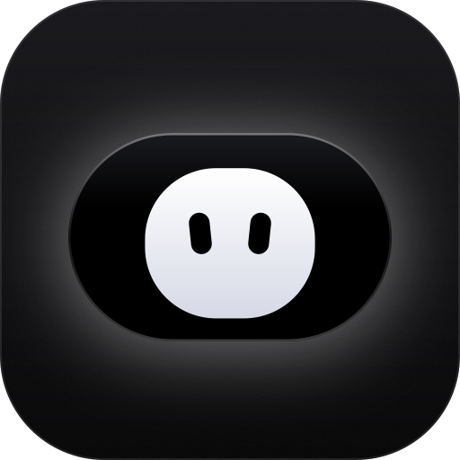

<p align="center">
  
</p>

<h1 align="center">Ilot</h1>

<p align="center">
  Une « Dynamic Island » pour Windows 11, et Notch, sa mascotte.<br>
  Développé par <a href="https://github.com/Xeiners">Xeiners</a>.
</p>

---

Une pilule noire en haut de l'écran. Survolez-la, elle s'ouvre ; cliquez dedans, elle reste ouverte jusqu'à un clic
ailleurs. Notch vit dedans : elle danse sur votre musique, réagit à vos copies et répond quand on clique dessus.

## Ce qu'elle fait

- **Musique** : le morceau en cours, ses paroles synchronisées (dans la notch ou dans la barre des tâches), un visualiseur.
- **Presse-papier** : vos dernières copies, à recoller en un clic.
- **Drop Zone** : glissez un fichier, son lien est copié ; ou envoyez-le sur votre téléphone, par le Wi-Fi.
- **Notes** et **Pomodoro**, toujours sous la main.
- **Révisions** : un cours devient une fiche, des flashcards et des cartes mentales, rangés par matière.
- **Recherche** (Ctrl + Q) : une appli, un fichier, un calcul, une page web.
- **Assistant IA** : cliquez sur Notch et posez votre question, par écrit ou à voix haute.

## Paramètres

Clic droit sur la notch → **Paramètres**.

| Section | Réglages |
|---|---|
| Général | Langue · Lancer avec Windows · Mode minimisé · Rester ouverte après un clic · Se cacher au repos (et son délai) · Mascotte et sa couleur · Masquer en plein écran · Accueil et visite guidée · Mises à jour automatiques |
| Poignée | Largeur de la poignée · Zone de détection |
| Recherche | Raccourci · Écran où elle s'ouvre · Garder la dernière recherche · Everything · Où chercher · Nombre de résultats · Dossiers ignorés |
| Paroles | Afficher les paroles · Ligne chantée (notch ou barre des tâches) · Largeur dans la barre des tâches · Retirer le lecteur de la notch fermée · Taille du texte |
| Presse-papier | Historique · Raccourci · Signaler chaque copie · Taille de l'historique · Effacer |
| Drop Zone | Hébergeur · Durée de vie des liens |
| Pomodoro | Durées du focus et des pauses · Sessions avant la grande pause · Enchaînement automatique · Carillon |
| Assistant | Clé API Gemini · Modèle · Volume de sa voix · Raccourci |

L'assistant et les révisions utilisent Google Gemini, avec une clé gratuite
([Google AI Studio](https://aistudio.google.com/apikey)) : elle reste sur l'ordinateur, dans le coffre de Windows.

## Installer

Windows 11, x64. Téléchargez `Ilot-Setup-<version>.exe` dans les [Releases](https://github.com/Xeiners/ilot/releases) et
lancez-le : pas de droits administrateur, rien d'autre à installer.

Ilot se met ensuite à jour tout seul : chaque nouvelle version publiée ici est téléchargée en arrière-plan et proposée
sur la notch (« Installer » ou « Plus tard », et alors au prochain démarrage).

## Compiler

Avec le SDK .NET 10 :

```
dotnet run --project src/Ilot
```

L'installateur (avec [Inno Setup 6](https://jrsoftware.org/isinfo.php)) :

```
powershell -ExecutionPolicy Bypass -File installer\build.ps1
```

Il sort dans `artifacts\Ilot-Setup-<version>.exe`.

Pour publier une nouvelle version : changez `<Version>` dans `Directory.Build.props` (par exemple `1.0.1`), construisez
l'installateur, puis créez une Release avec le tag `v1.0.1` et le fichier `Ilot-Setup-1.0.1.exe` : les Ilot installés
la trouvent d'eux-mêmes.

## Licence

Ilot est sous [licence MIT](LICENSE), Copyright (c) 2026 [Xeiners](https://github.com/Xeiners) : chacun peut
réutiliser, modifier et même vendre le code, à condition de garder le nom de l'auteur et la licence. Les composants
tiers gardent la leur : voir [THIRD-PARTY-NOTICES.md](THIRD-PARTY-NOTICES.md).

## Plus de détails

- [Chaque fonctionnalité en détail](docs/FONCTIONNALITES.md)
- [Notes de développement](HANDOFF.md)
